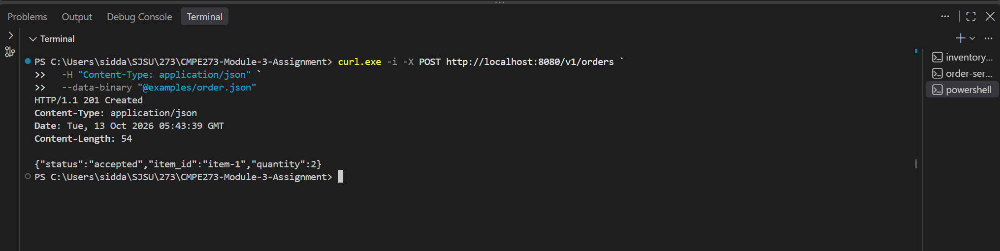
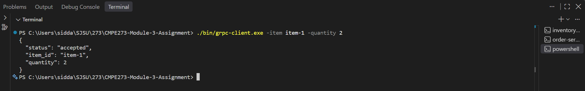
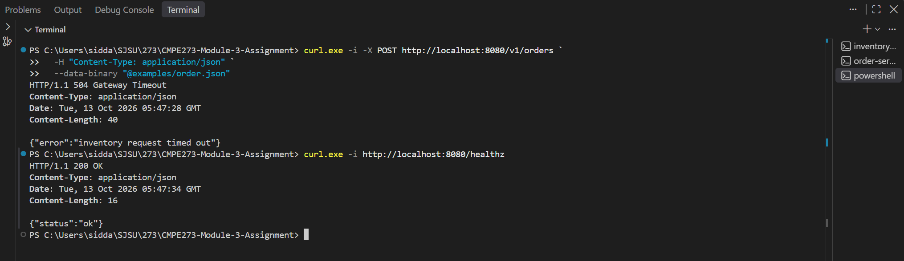
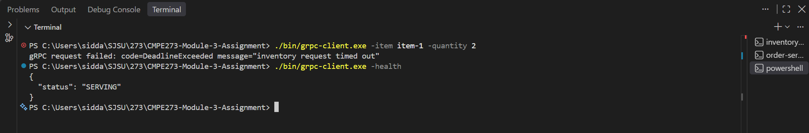

# REST and gRPC Order-to-Inventory Services

This repository implements the same Order-to-Inventory interaction using REST/JSON and gRPC in Go. The Inventory Service exposes REST on port `8081` and gRPC on port `50051`. The Order Service exposes REST on port `8080` and gRPC on port `50050`; REST orders call Inventory over HTTP, while gRPC orders call Inventory over gRPC. Both downstream calls use a one-second timeout or deadline by default.

## Architecture

```text
REST client -> Order REST :8080 -> Inventory REST :8081
gRPC client -> Order gRPC :50050 -> Inventory gRPC :50051
```

The in-memory inventory is deterministic:

| Item | Available quantity |
|---|---:|
| `item-1` | 10 |
| `item-2` | 3 |
| `item-3` | 0 |

Inventory checks do not reduce stock, which keeps the demonstrations repeatable.

## Prerequisites

- Go 1.24 or newer
- PowerShell for the commands shown below
- Three terminal windows

No protobuf compiler or external gRPC command-line utility is required. Generated protobuf files and a small Go gRPC client are included in the repository.

## Build and test

From the repository root:

```powershell
New-Item -ItemType Directory -Force bin | Out-Null
go build -o bin/inventory-service.exe ./cmd/inventory-service
go build -o bin/order-service.exe ./cmd/order-service
go build -o bin/grpc-client.exe ./cmd/grpc-client
go test ./...
```

On macOS or Linux, omit the `.exe` suffix and run the corresponding files from `./bin/`.

## Run the services normally

Open Terminal 1 and start Inventory without an artificial delay:

```powershell
$env:INVENTORY_DELAY="0s"
./bin/inventory-service.exe
```

Expected startup output:

```text
inventory REST server listening on :8081
inventory gRPC server listening on :50051
```

Open Terminal 2 and start Order. Keep this process running throughout both the success and failure demonstrations:

```powershell
$env:ORDER_INVENTORY_TIMEOUT="1s"
./bin/order-service.exe
```

Expected startup output:

```text
order REST server listening on :8080
order gRPC server listening on :50050
inventory timeout/deadline: 1s
```

## Successful REST request

In Terminal 3, send an order using the included JSON file:

```powershell
curl.exe -i -X POST http://localhost:8080/v1/orders `
  -H "Content-Type: application/json" `
  --data-binary "@examples/order.json"
```

Expected response:

```http
HTTP/1.1 201 Created
Content-Type: application/json

{"status":"accepted","item_id":"item-1","quantity":2}
```

### REST success evidence



## Successful gRPC request

The included client calls `OrderService.CreateOrder`, which then calls `InventoryService.CheckInventory` over gRPC:

```powershell
./bin/grpc-client.exe -item item-1 -quantity 2
```

Expected response:

```json
{
  "status": "accepted",
  "item_id": "item-1",
  "quantity": 2
}
```

### gRPC success evidence



## Failure demonstration: slow Inventory Service

Leave the Order Service in Terminal 2 running. In Terminal 1, stop only Inventory with `Ctrl+C`, enable a three-second delay, and restart it:

```powershell
$env:INVENTORY_DELAY="3s"
./bin/inventory-service.exe
```

The delay is longer than Order's one-second REST timeout and gRPC deadline.

### REST timeout handling

In Terminal 3, run the REST order and then immediately check Order's health:

```powershell
curl.exe -i -X POST http://localhost:8080/v1/orders `
  -H "Content-Type: application/json" `
  --data-binary "@examples/order.json"

curl.exe -i http://localhost:8080/healthz
```

Expected results:

```http
HTTP/1.1 504 Gateway Timeout
Content-Type: application/json

{"error":"inventory request timed out"}

HTTP/1.1 200 OK
Content-Type: application/json

{"status":"ok"}
```

The `504` shows that the downstream timeout was handled cleanly. The following `200 OK` health response proves that the same Order process remained running.

### REST timeout and survival evidence



### gRPC deadline handling

With the delayed Inventory Service still running, invoke gRPC and then check Order's gRPC health service:

```powershell
./bin/grpc-client.exe -item item-1 -quantity 2
./bin/grpc-client.exe -health
```

Expected results:

```text
gRPC request failed: code=DeadlineExceeded message="inventory request timed out"
{
  "status": "SERVING"
}
```

The first result demonstrates the exceeded downstream deadline. The `SERVING` result proves that the same Order gRPC server remained available after the failure.

### gRPC deadline and survival evidence



After capturing the failure evidence, stop Inventory with `Ctrl+C` and restart it with `INVENTORY_DELAY=0s` for normal operation. The Order Service does not need to be restarted.

## Error behavior

| Condition | REST Order response | gRPC Order response |
|---|---|---|
| Invalid item ID or quantity | `400 Bad Request` | `InvalidArgument` |
| Unknown item | `409 Conflict` | `NotFound` |
| Insufficient quantity | `409 Conflict` | `FailedPrecondition` |
| Inventory too slow | `504 Gateway Timeout` | `DeadlineExceeded` |
| Inventory unreachable | `503 Service Unavailable` | `Unavailable` |

## Configuration

| Environment variable | Default | Purpose |
|---|---|---|
| `INVENTORY_REST_ADDR` | `:8081` | Inventory REST listener |
| `INVENTORY_GRPC_ADDR` | `:50051` | Inventory gRPC listener or Order's gRPC target |
| `INVENTORY_DELAY` | `0s` | Artificial delay applied by Inventory |
| `ORDER_REST_ADDR` | `:8080` | Order REST listener |
| `ORDER_GRPC_ADDR` | `:50050` | Order gRPC listener |
| `INVENTORY_REST_URL` | `http://localhost:8081` | Order's Inventory REST target |
| `ORDER_INVENTORY_TIMEOUT` | `1s` | REST timeout and gRPC deadline |

Duration values use Go syntax such as `250ms`, `1s`, or `3s`.

## REST versus gRPC comparison

REST was straightforward to inspect because its JSON payloads and HTTP status codes work directly with common tools such as curl. 
gRPC required a protobuf contract and generated Go bindings, which added a setup step but provided strongly typed clients and servers. 
REST timeout handling depended on the HTTP client's timeout and explicit translation to `504 Gateway Timeout`, while gRPC propagated deadline semantics through contexts and the standard `DeadlineExceeded` status. 
The protobuf contract reduced ambiguity between services, whereas the REST request and response structures had to be kept consistent manually. 
For this small example REST was simpler to debug by hand, while gRPC offered a more structured service contract and clearer machine-to-machine status model.

## Repository

[https://github.com/SiddarthVuppunahalli/CMPE273-Module-3-Assignment](https://github.com/SiddarthVuppunahalli/CMPE273-Module-3-Assignment)
